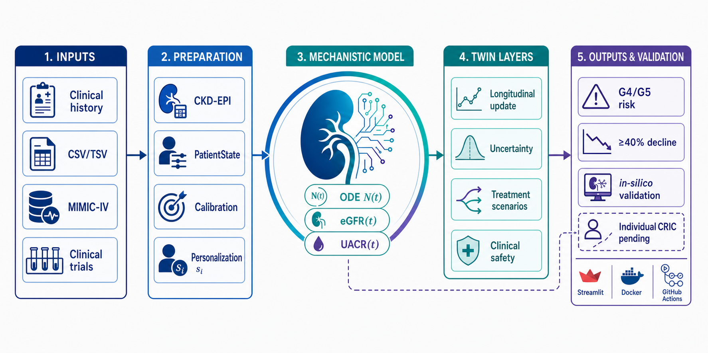
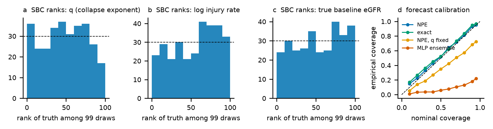

<h1>
  
  NephroQ
</h1>

## A mechanistic digital twin for Type 2 Diabetes → Chronic Kidney Disease


[](https://colab.research.google.com/github/Danpc11/nephroq/blob/main/risk_notebook.ipynb)

A calibratable, nonlinear mechanistic model of renal function (eGFR) progression
in type 2 diabetes. It projects the trajectory of eGFR **and of albuminuria**, and
the time to a **modeled eGFR < 15 mL/min/1.73 m² threshold** — a kidney-function
threshold, **not** a prediction of when dialysis would actually start (real KRT
initiation depends on symptoms, labs and clinical judgment).

**Why "NephroQ":** `q` is the hyperfiltration feedback exponent — how strongly
the structural hazard rises with the load on the remaining functional capacity
before it saturates. It does not by itself make decline accelerate (with the
trial calibration it never does; see *How the model works*). It is a
**population-level structural parameter**: the repository's own experiments show
`q` is close to unidentifiable from routine clinical data (see
[Per-patient personalization](#per-patient-personalization-ai)). Individual
heterogeneity is therefore captured not through `q` but through a **personal
injury-rate multiplier**, which *is* recoverable. That is a more useful — and
more honest — claim than "we estimate each patient's `q`".

---

## Table of contents

- [**Workflow**](#Workflow)
- [Quick start (2 minutes)](#quick-start-2-minutes)
- [How the model works](#how-the-model-works)
- [**Per-patient personalization (AI)**](#per-patient-personalization-ai)
- [**The digital-twin system**](#the-digital-twin-system)
- [Where the parameters come from](#where-the-parameters-come-from)
- [**Using your own data**](#using-your-own-data) ← start here to calibrate
- [Optional: calibrating with MIMIC-IV](#optional-calibrating-with-mimic-iv)
- [Validation: check the model yourself](#validation-check-the-model-yourself)
- [Repository structure](#repository-structure)
- [Limitations](#limitations)

---
## Workflow


---

## Quick start (2 minutes)

**You do not need any data to run NephroQ.** It ships with parameters anchored to
published clinical trials, so it works out of the box.

```bash
git clone https://github.com/Danpc11/nephroq.git
cd nephroq
python -m venv venv && source venv/bin/activate
pip install -r requirements.txt          # or requirements-lock.txt to reproduce exactly

streamlit run app_web.py          # interactive app (English / Spanish)
```

Click one of the **four example patients** in the sidebar to see the model's
behavior without typing anything. For a guided 7-minute walkthrough aimed at
clinicians, see [`docs/CLINICIAN_DEMO.md`](docs/CLINICIAN_DEMO.md).

**No installation at all:** open
[`risk_notebook.ipynb` in Colab](https://colab.research.google.com/github/Danpc11/nephroq/blob/main/risk_notebook.ipynb)
and run all cells. The code is hidden; you just get the controls.

### Using the model from Python

```python
import sys; sys.path.insert(0, "src")
import model_core as core

t, egfr, uacr, t_threshold = core.simulate_trajectory_v2(
    egfr0=47.7,      # baseline eGFR (mL/min/1.73m2)
    a1c=8.1,         # HbA1c (%)
    uacr0=145.0,     # baseline UACR (mg/g)
    sbp=142.0,       # systolic blood pressure (mmHg)
    u=0.0,           # 0 = untreated, 1 = renoprotective therapy (SGLT2i / ACEi-ARB)
    years=15,
)
print(f"eGFR<15 reached at {t_threshold:.1f} years")
print(f"UACR goes {uacr[0]:.0f} -> {uacr[-1]:.0f} mg/g")
```

Set `u=1.0` for the treated counterfactual of the same patient. Note that
**albuminuria is an output**, not an input held constant: it rises as nephrons are
lost, and falls under treatment.

---

## How the model works

A low-dimensional ODE for the surviving fraction of functional nephrons `N`:

```
dN/dt = -N * h(N)

h(N) = k0
     + k_hf * structural(N)          hyperfiltration (dominant at low UACR)
     + k_alb * log(1 + UACR(t)/30)   albuminuric (dominant at high UACR)
     + metabolic(HbA1c, SBP)
```

Four ideas do the work:

1. **Hyperfiltration feedback.** As functional capacity is lost, the remaining
   units are loaded more and the hazard rises — with exponent `q` — until it
   **saturates** (a surviving nephron raises its single-nephron GFR ~3x, not
   without limit; saturation begins near eGFR 44). Whether this makes eGFR
   decline *accelerate* is a quantitative question: it does only where the
   hazard's elasticity to eGFR is below −1, which needs `q` above ~2 and happens
   only above eGFR ≈ 36–40 (`src/dynamics_regimes.py`; derivation in
   `docs/MODEL_DOCUMENTATION.md` §2.6).
2. **Two coexisting insults.** A structural (hyperfiltration) term and a separate
   albuminuric term, each with its own coefficient. The patient's own UACR decides
   which dominates: low UACR → structural, high UACR → albuminuric. This is what
   lets one parameter set describe both a near-normoalbuminuric primary-care
   population and the macroalbuminuric populations of the SGLT2i trials.
3. **No terminal collapse.** Every hazard term is bounded, so the model has no
   finite-time collapse or bifurcation; below the saturation point the decline
   decelerates for every parameter value.
4. **Endogenous albuminuria.** UACR is a *consequence* of glomerular
   hypertension, not an external driver. The model predicts its trajectory — and
   predicts that renoprotective therapy lowers it ~29% immediately (SGLT2i trials
   published **31–35%**).

**The feedback exponent `q` is population-dependent at the population level**
(`q ≈ 2.9` on progressing CKD in MIMIC-IV, k-fold CV 3%, vs 1.52 in the trials),
but it is weakly identified per patient, and its numerical value depends on how
the load is defined (`1/N` here; the per-unit filtration `N^(α−1)` gives an
exactly equivalent model with `q` five times larger). Read it as a shape
parameter of the hazard, not as a biological constant — see
`docs/MODEL_DOCUMENTATION.md` §2.2 and §2.6.

Full mathematical specification: [`docs/MODEL_DOCUMENTATION.md`](docs/MODEL_DOCUMENTATION.md).

---

## Per-patient personalization (AI)

The app is used one patient at a time — but a population model gives every
patient with the same eGFR the same future. **If you supply a few past
creatinine values, NephroQ infers that patient's own parameters.**

Two patients with an identical eGFR of 55 today:

The headline output is the **injury rate**, not `q`:

| History | Inferred injury rate | Modeled time to eGFR<15 |
|---|---|---|
| Falling fast (85 → 55 over 3 years) | **2.01×** population | **5.4 years** |
| Nearly flat (58 → 55 over 3 years) | **0.44×** population | **> 20 years** |
| *(no history — population model)* | *1.00×* | *13.9 years for **both*** |

### How it works

A neural network solves the **inverse problem**: given a handful of noisy eGFR
measurements, it infers the patient's personal injury rate (and, as a diagnostic
only, an estimate of `q`). The **forward projection is still the mechanistic
ODE**, run with the **population `q`** and the patient's inferred injury rate — the
network never predicts the trajectory itself. This is a hybrid model, not a black
box: its output is a physically meaningful number.

The estimator is trained **entirely on simulations from the mechanistic model**
(*amortized / simulation-based inference*), so **no patient data is required to
train it**.

The estimator is **not** committed to the repo. It is derived entirely from
simulations of the mechanistic model, so on first use (or whenever it is missing,
or unloadable because your scikit-learn pickles differently) it is **trained on
demand** (~13 s) and cached to `calibration/personalizer.pkl` for instant starts
thereafter. So the first request pays a one-time ~13 s cost; every later one is
instant. Nothing to fetch, nothing to break — and no stale binary pickle to keep
in sync with your scikit-learn version.

```bash
cd src
python personalize.py --train      # retrain + validate explicitly
python personalize.py              # validate the shipped estimator
```

### Does it earn its place?

Validated on 400 held-out virtual patients, forecasting eGFR **5 years past the
last visit**, with the personalizer **exactly as the app runs it** (population
`q`, inferred injury rate). Each virtual patient carries its own true `q`, so
fixing `q` at the population value is itself under test.

| Method | Forecast RMSE (mL/min/1.73 m²) | Speed per patient |
|---|---|---|
| Population parameters (no personalization) | 16.01 | — |
| **Amortized network (deployed)** | **10.33** (−35 %) | 0.9 ms |
| Least squares, injury rate only (fair classical rival) | 11.27 (−30 %) | 4.4 ms |

Personalization earns its place: about a third less forecast error than the
population model. Against the fair classical rival — one-parameter least
squares solving the same problem — the network is modestly more accurate and
about 5× faster. Two diagnostic rows printed by `python personalize.py` show why
the structural exponent is left at its population value in this path: a
two-parameter least-squares fit that also chases `q` does worse (12.24), because
`q` is not identifiable and fitting it spends the noise budget on the wrong
parameter.

What this deployed estimator does **not** give is honest uncertainty: its
ensemble spread is far too narrow (see the next section). The full Bayesian
personalizer below fixes that.

### Full Bayesian personalization (research module)

`src/npe_posterior.py` infers the patient's **full posterior** over the feedback
exponent `q`, the log injury rate and the true (noise-free) baseline eGFR, by
**amortized neural posterior estimation**: a GRU reads the visit sequence
directly (any number of visits, any spacing), and a conditional neural spline
flow returns the posterior. It is trained once on 200 000 virtual patients
(~9 min on 2 CPU cores) and then answers in milliseconds. The forecast is the
**posterior predictive**: every posterior draw, including the uncertain `q`, is
projected with the mechanistic ODE. Nothing is fixed that the data cannot pin
down; the unidentifiable exponent is integrated over instead.

The benchmark (`python benchmark_posterior.py`) scores every method on 300
held-out virtual patients (2–9 visits over 0.5–8 years, noise SD 6) against an
**exact Bayesian posterior** computed by brute force on a 3-D grid under the same
prior and likelihood:

| Method | Forecast RMSE | 90 % interval coverage | CRPS | ms / patient |
|---|---|---|---|---|
| Population parameters | 24.87 | — | — | — |
| MLP ensemble (current app) | 12.46 | **33 %** | 7.11 | 2.7 |
| Least squares, rate only | 11.29 | — | — | 5.5 |
| Least squares, rate + baseline eGFR | 10.39 | — | — | 172 |
| **NPE (posterior predictive)** | **9.47** | **91 %** | **3.63** | 61 |
| NPE with `q` fixed at population (ablation) | 11.87 | 83 % | 5.49 | — |
| Exact posterior (grid reference) | 9.35 | 92 % | 3.59 | 962 |



Three results:

1. **The neural posterior matches the exact one** in accuracy and calibration
   (RMSE 9.47 vs 9.35; 90 % intervals cover 91 % vs 92 %) at ~1/16 of the cost.
   Simulation-based calibration ranks (panels a–c) are consistent with uniform
   (all SBC p ≥ 0.05).
2. **The current MLP ensemble is badly overconfident**: its nominal 90 %
   intervals contain the truth 33 % of the time (panel d). Ensemble spread is not
   a posterior.
3. **Integrating over `q` beats fixing it.** Replacing the posterior draws of `q`
   by the population value raises the error from 9.47 to 11.87 and drops the
   90 % coverage to 83 %. `q` is weakly identified per patient (the data shrink
   its prior variance by only 12–21 %), but the forecast still needs its
   uncertainty.

Honest limits of this module: it is trained on simulations of *this* model, so
it inherits every assumption of the model; the network contracts `q` somewhat
more than the exact posterior (21 % vs 12 %) and the SBC test for the baseline
eGFR is at the threshold (p = 0.05), so a larger training set or an ensemble of
flows may help; and the app still uses the MLP ensemble until the module is wired
in. The fit to real patients is tested by the MIMIC-IV validation below. Install with `pip install -r requirements-npe.txt`.

### Patient-level validation on real trajectories (MIMIC-IV)

`src/validate_mimic_patients.py` runs the patient-level protocol on the MIMIC-IV
cohort built by `mimic_loader.py`: each eGFR series is thinned to one median
value per 90 days, every method personalizes on the **first 2 years** after the
confirmed index and nothing later, and held-out visits are scored at ~1, ~3 and
~5 years after the last observed visit (one visit per patient per horizon). The
split is **temporal** (the most recent `anchor_year_group`s are the test set)
when `patients.csv.gz` is given.

**Temporal integrity.** Each trajectory is cut at the forecast origin *before*
anything is computed; the index is confirmed and every covariate is taken from
the observed window only, and missing covariates are imputed with training
medians. A test rewrites all data after the origin and checks that nothing
before it changes. The report includes a cohort-selection table (included vs
excluded) and a provenance block (commit, model-configuration hash, cohort hash,
network-weight hashes, package versions).

Only the training patients are used to learn four things, in order: a
**Student-t measurement-noise model** (fitted to short-interval eGFR differences
by matching simulated differences of two Student-t errors; it absorbs acute
spikes), a **stage-1 neural posterior** under the uniform prior
box, a **population prior** over (`q`, log injury rate) by empirical Bayes over
the stage-1 draws (`population_prior.py`), and a **stage-2 neural posterior
retrained on simulations from that prior**. The mechanistic network is never
fitted to MIMIC trajectories; only the noise model and the population prior are
estimated from them. On top, a **hybrid** adds a gradient-boosting correction
learned on the residuals of the stage-2 forecast.

Ten methods are compared on the same visits: population model, one-parameter
least squares, the MLP ensemble, NPE under the uniform prior, NPE reweighted to
the learned prior, NPE retrained on it, the hybrid, a per-patient OLS slope, an
empirical-Bayes random-slope model and gradient boosting. Scores: RMSE, MAE,
bias, interval coverage and CRPS by horizon, AUC and Brier for eGFR < 30, and
patient-bootstrap CIs of every RMSE difference against the retrained NPE and
against gradient boosting.

Run it where MIMIC lives (credentialed access required; see
`docs/MIMIC_COMPLIANCE.md`). Both networks are trained and cached on first use:

```bash
cd src
python mimic_loader.py --mimic-dir <mimic>/hosp --out ../data/_mimic_cohort.tsv
python validate_mimic_patients.py --cohort ../data/_mimic_cohort.tsv \
    --patients <mimic>/hosp/patients.csv.gz
```

It writes per-patient rows to a `.csv` in the output directory (they must stay
on that machine) and the **aggregate** report `mimic_patient_validation.md` and
`.png`, which are the only outputs that may be shared. On a compute node, set
`NEPHROQ_OUT_DIR` (see *Running analyses on a compute node*).

**Result** (MIMIC-IV 3.1; 8 672 training and 858 temporally held-out test
patients; 1 261 held-out visits; full report in
[`results/mimic_patient_validation.md`](results/mimic_patient_validation.md)):

| Method | RMSE | MAE | 90 % coverage | CRPS | AUC, eGFR < 30 |
|---|---|---|---|---|---|
| Population parameters | 18.21 | 13.59 | — | — | — |
| MLP ensemble (current app) | 16.42 | 12.14 | 70 % | 9.18 | 0.887 |
| Least squares, rate only | 16.25 | 11.84 | — | — | — |
| NPE, uniform prior | 16.86 | 12.26 | 80 % | 8.79 | 0.869 |
| **NPE, retrained on the learned prior** | 15.34 | 10.85 | 79 % | 8.16 | 0.858 |
| **Hybrid (NPE + residual correction)** | **14.24** | **10.25** | **86 %** | **7.45** | **0.891** |
| Mixed-model slope (empirical Bayes) | 20.57 | 14.18 | 73 % | 10.80 | 0.851 |
| Gradient boosting (trained on MIMIC) | 14.39 | 10.39 | 85 % | 7.56 | 0.889 |

- The mechanistic posterior, which learns only a noise model and a 9-parameter
  population prior from MIMIC, beats every classical per-patient method and the
  current app (bootstrap ΔRMSE vs least squares +0.07 to +1.64; vs the MLP
  ensemble +0.24 to +1.86), and removes the uniform prior's decline bias
  (−5.37 → −0.15 mL/min/1.73 m²). It remains behind gradient boosting trained on
  the same hospital (+0.39 to +1.60) and under-covers (79 %).
- The **hybrid** is statistically indistinguishable from gradient boosting in
  RMSE (−0.40 to +0.11) and numerically ahead on MAE, CRPS, coverage and AUC
  (confidence intervals for those differences are still to be computed), while
  every forecast still runs through the mechanistic model. No superiority is
  claimed.
- A **two-component population prior** fits held-out patients better than one:
  87 % with a median injury rate of 0.40× the trial-anchored population and 13 %
  at 4.23×. A better-fitting mixture is evidence of heterogeneity, not of two
  discrete phenotypes; its stability (bootstrap, three components, alternative
  noise models) is still to be tested. How the fast decline divides between a
  higher injury rate and a larger feedback exponent depends on the prior box and
  the noise model (with a 3× ceiling and Gaussian noise the split appeared in
  `q`, 1.02 vs 2.93), so its attribution to `q` is not a finding.
- The 5-year horizon has only 39 held-out visits; its numbers are indicative.

### Honest limits

- **`q` is essentially unidentifiable from routine data** (R² ≈ 0.0) — and no
  assay fixes that, cystatin C included. Almost all of the benefit comes from
  inferring the patient's **injury rate**, which *is* recovered well. Treat a
  reported `q` as indicative only.

### What to measure (you do not need cystatin C)

Simulation experiments on parameter recovery of the patient's injury rate:

| Measurement strategy | Rate recovery (R²) |
|---|---|
| Creatinine only, short history | 0.48 |
| + cystatin C | 0.67 |
| **+ duplicate creatinine per visit, long history** | **0.71** |
| + cystatin C *and* long history | 0.75 |

**The single most valuable thing is the TIME SPAN of the history, not the number
of measurements.** The same 4–6 creatinine values spread over 4–8 years recover
the rate three times better (R² 0.59) than the same number crammed into 1–2 years
(0.18) — and better than 10–14 values inside a short window (0.34).

Practical consequence: **pull the patient's old creatinine results from the
chart.** They already exist, they cost nothing, and they beat buying a new assay.

Serial **UACR does not help** (R² 0.47 vs 0.48). In this model albuminuria is a
deterministic function of the same latent state, so it adds no independent
information — and it carries large biological noise.
- It needs **≥ 3 measurements spanning ≥ 9 months**. With less, the app says so
  and falls back to population parameters rather than inventing a
  personalization.
- It is trained on simulations from *this* model, so it inherits every assumption
  the model makes. It infers "the parameters that best explain these points
  **under this model**", not ground truth.

---

## The digital-twin system

Beyond a single projection, NephroQ carries a set of layers that turn the
mechanistic model into a longitudinal, clinically-framed digital twin. Each layer
is data-and-orchestration only — the biology stays in `model_core.py`.

**Longitudinal patient state** (`patient_state.py`). A `PatientState` holds a
patient's history as an ordered list of `Visit`s, each lab a `Measured` value that
records its unit, source, and whether it was observed or imputed. This is the
object a twin is built around, and it is fed by a clinical data layer
(`clinical_data.py`) that loads CSV/TSV, reconciles column-name synonyms, reports
per-field **missingness**, and **flags out-of-range values instead of silently
trusting or dropping them**. FHIR/OMOP adapters are declared but not faked.

**Continuous update** (`digital_twin.py`). A twin is not projected once and frozen.
Each new visit runs `forecast → observe → score the previous forecast →
re-personalize → new forecast`, and it keeps the prediction-vs-observation trace —
the raw material for earning (or losing) trust over time.

**Treatment scenarios** (`treatment_engine.py`). Named drugs (SGLT2 inhibitor,
RAAS inhibitor, finerenone, GLP-1 RA), each with its own mechanism, evidence base,
and uncertainty range, combining multiplicatively so a regimen never exceeds full
blockade. This is **scenario evaluation, not treatment recommendation** — every
scenario is shown with the population its effect was estimated in.

**Acute events** (`acute_events.py`). AKI episodes and the SGLT2i initiation dip are
modelled as transient deflections *on top of* the chronic trajectory
(`eGFR_observed = eGFR_chronic − D(t)`), so `N(t)` stays monotonic. An AKI episode
can raise the patient's susceptibility afterward, and a recovering dip can be
flagged so it is not mistaken for a chronic baseline.

**Full predictive uncertainty** (`uncertainty.py`). The band decomposes into five
sources — population, personalization, measurement, future covariates, and
structural model error — kept separate so the interface can say *why* a projection
is uncertain, and therefore what would reduce it.

**Clinical outputs** (`clinical_outputs.py`). KDIGO-framed quantities a clinician
reasons with: P(≥40% eGFR decline), P(G4), P(G5) by horizon, time to G3b/G4/G5,
probability of rapid progression, expected category change, and a referral flag.
It reports P(eGFR<15), **never a "dialysis start date"**.

**Clinical safety** (`clinical_safety.py`). The twin knows when not to trust
itself: verdicts of `prediction_available`, `prediction_with_caution`,
`insufficient_data`, `out_of_validated_domain`, or `do_not_use_for_scenarios`,
each with specific reasons, always shown with the model's provenance and a
`research use — not prospectively validated` label.

---

## Where the parameters come from

NephroQ resolves parameters across **three tiers**, highest priority first. The
app always displays which one is active.

| Tier | Source | When it is used |
|---|---|---|
| 1. Private | `.streamlit/secrets.toml` | If you have your own clinical-cohort calibration |
| 2. MIMIC-IV | `calibration/mimic_calibration.json` | Only if **you** generated it locally (see below) |
| 3. **Default (ships with the repo)** | **Published clinical trials** | **Automatically — no data required** |

**The default tier is trial-anchored.** Progression is fixed by the placebo arms
of **CREDENCE** and **EMPA-KIDNEY**; treatment effects by **CREDENCE**. Then
**DAPA-CKD is predicted out-of-sample**, and both its chronic eGFR slope and its
UACR reduction land inside the published 95% CI. No patient-level data is needed,
because the anchors are published aggregate results.

---

## Using your own data

**This is the recommended way to calibrate NephroQ for your population.** You do
**not** need MIMIC-IV. Any longitudinal cohort with repeated creatinine works.

### 1. Format your data as a TAB-separated file (`.tsv`)

One row per visit, per patient:

```
patient_id	time_years	egfr	hba1c	uacr	sbp
P001	0.0	58.2	8.4	180	145
P001	0.6	55.1	8.1	210	142
P001	1.4	51.7	8.6	260	148
P002	0.0	72.4	7.2	45	132
```

Tabs, not commas: clinical exports routinely contain commas inside fields
(free-text sites, `"Apellido, Nombre"`), which silently corrupt a CSV. A
comma-separated file still works — the delimiter is sniffed from the header —
but tabs are what this expects.

| Column | Meaning | Required |
|---|---|---|
| `patient_id` | any stable identifier | yes |
| `time_years` | years since that patient's index visit (first = 0) | yes |
| `egfr` | mL/min/1.73 m2 (CKD-EPI 2021; see `src/egfr_measurement.py`) | yes |
| `hba1c` | % | recommended |
| `uacr` | mg/g | recommended |
| `sbp` | mmHg | recommended |

Missing covariates are allowed (leave the cell empty). A missing **baseline**
covariate is filled with the **cohort's baseline median** — never with that
patient's own later visits, which would leak the future into a baseline forecast —
and the fraction imputed is **reported**, not hidden. But `uacr` carries a large share of the
hazard, so a cohort with poor UACR coverage will not identify its weight well.

**Minimum per patient:** at least 4 eGFR measurements spanning at least 180 days.
Shorter trajectories cannot constrain the curvature.

### 2. Calibrate and validate

```bash
cd src
CKD_DATA=../data/my_cohort.tsv python mvp_calibration.py
```

This fits the model, compares it against a linear-slope baseline, tests whether it
discriminates progressors, and writes a one-page report to
`results/validation_report.md` you can hand to clinical collaborators.

### 3. Read the diagnostics before trusting anything

The calibration prints an explicit quality verdict. If it reports
`quality_status = warning`, **the app refuses to use those parameters** and falls
back to the trial-anchored defaults unless you explicitly opt in. That is
deliberate: a warning printed above a plot does not undo the plot.

It will tell you, loudly, about: an optimizer that never moved off its initial
guess, a chi2/n far from 1, a cohort where most "patients" do not actually
decline, and how much of your covariate data was imputed.

---

## Optional: calibrating with MIMIC-IV

MIMIC-IV is **one option among several, not a requirement.** NephroQ ships and runs
without it. It is a useful large public testbed — but it is an ICU/hospital
database, which brings real problems (see [Limitations](#limitations)).

### You must request access yourself — we cannot give you the data

MIMIC-IV is a **credentialed** dataset. This repository contains **no patient
data**, and no MIMIC-derived file is ever committed (see `.gitignore`). To use it:

1. Create a [PhysioNet](https://physionet.org/) account.
2. Complete the required **CITI "Data or Specimens Only Research"** training.
3. Sign the MIMIC-IV **Data Use Agreement** and become credentialed.
4. Download MIMIC-IV v3.1 yourself.

See [`docs/MIMIC_COMPLIANCE.md`](docs/MIMIC_COMPLIANCE.md) for the handling rules
this project follows. **Please do not ask the authors for the data, and do not
redistribute it.**

### Running the calibration

The data never leaves your machine.

```bash
cd src
python calibrate_mimic.py --mimic-dir /path/to/mimiciv/3.1/hosp --chronic-only
```

It writes `calibration/mimic_calibration.json`, which the app then picks up
automatically (tier 2). That file is **git-ignored** — it is yours to keep, or to
share "upon reasonable request" in a publication.

Useful flags:

```bash
--chronic-only        # keep only net-declining, lower-volatility trajectories
--cv-folds 5          # K-fold CV: is each parameter even IDENTIFIABLE from this cohort?
--n-jobs -1           # use every core (see below) -- results are IDENTICAL to serial
--n-bootstrap 200     # 15 = smoke test ONLY; 100-200 preliminary; 500-1000 for a manuscript
--keep-cohort        # KEEP the cohort file (TSV) -- otherwise it is deleted after the fit
--from-cohort path   # reuse it, skipping the slow re-read of labevents.csv.gz
```

**Speed.** The fit integrates one ODE per patient per residual evaluation, so a full
run on thousands of patients is expensive. Two things make it tractable:

- the predictor integrates **straight onto the visit times** rather than onto a dense
  grid it then interpolates — ~**7× faster**, and numerically identical (<10⁻⁶ mL/min);
- `--n-jobs` splits the patients across cores. They are independent, and the residual
  vector is reassembled in the **original patient order**, so the optimizer sees exactly
  what it would have seen serially. A regression test asserts the two agree to 10⁻⁹.

Do a cheap diagnostic run before committing to a long one:

```bash
python calibrate_mimic.py --from-cohort ../data/_mimic_cohort.tsv \
    --chronic-only --n-jobs -1 --n-bootstrap 0 --max-patients 800
```

Then audit whatever it produces **before** trusting it:

```bash
python audit_calibration.py
```

---

## Validation: check the model yourself

The model is validated against **published randomized trials**, and the test is
built so it **can fail**.

```bash
cd src
python insilico_trial.py       # in-silico replication of 3 trials
```

Parameters are fitted on **CREDENCE** (with **EMPA-KIDNEY** anchoring the
saturation ceiling), then **frozen**. **DAPA-CKD is predicted out-of-sample**,
from its published baseline characteristics alone — no parameter is left to turn.
Agreement on the fitted trials is guaranteed by construction and is *not*
evidence; all the weight is on DAPA-CKD:

| DAPA-CKD (held out) | Model | Published |
|---|---|---|
| Chronic eGFR slope difference | **2.10** | 2.26 (95% CI 1.88–2.64) — PASS |
| UACR reduction | **31.0 %** | 35.1 % (95% CI 30.6–39.4) — PASS |
| Placebo-arm slope | −3.51 | −3.83 |

The run writes `results/insilico_trial_report.md`.

```bash
python -m pytest tests -q      # 183 tests
```

---

## Running analyses on a compute node

Every analysis script writes its reports and figures to `results/` by default.
On a machine that only *runs* analyses (a cluster node), point them outside the
clone so the clone stays identical to the remote and `git pull` never collides
with generated files:

```bash
export NEPHROQ_OUT_DIR=/path/outside/the/repo/nephroq_runs   # e.g. in ~/.bashrc
```

Precedence is `--out-dir` (on `benchmark_posterior.py`, `validate_mimic_patients.py`
and `insilico_trial.py`) > `NEPHROQ_OUT_DIR` > `results/`. The files committed under
`results/` are updated deliberately from the aggregate reports, never as a side
effect of a run. Per-patient outputs from MIMIC-IV must stay on the node.

---

## Repository structure

```
nephroq/
├── app_web.py                  # interactive app (English / Spanish)
├── risk_notebook.ipynb         # Colab notebook (Nature-style figures)
├── requirements.txt
├── src/
│   │  # -- core model --
│   ├── model_core.py           # THE model — single source of truth (two-term hazard)
│   ├── egfr_measurement.py     # CKD-EPI 2021/2012 (creatinine / cystatin / combined)
│   ├── i18n.py                 # UI strings (EN/ES) + example patients
│   │  # -- calibration & validation --
│   ├── insilico_trial.py       # falsifiable validation against 3 published trials
│   ├── mvp_calibration.py      # calibrate + validate on YOUR data
│   ├── calibrate_mimic.py      # optional: calibrate on MIMIC-IV
│   ├── mimic_loader.py         # optional: MIMIC-IV cohort builder
│   ├── measurement_strategy.py # what is worth measuring (simulation experiments)
│   ├── audit_calibration.py    # gate: reproduce published placebo arms or don't ship
│   ├── external_validation.py  # external cohorts (CRIC): population + patient-level
│   │  # -- personalization & the digital twin --
│   ├── personalize.py          # per-patient AI (amortized inference; personalizes s_i)
│   ├── npe_posterior.py        # full Bayesian personalization (neural posterior, optional)
│   ├── benchmark_posterior.py  # NPE vs exact posterior vs classical baselines
│   ├── fast_sim.py             # vectorized copy of the hazard, for simulation-based inference
│   ├── outputs.py              # where scripts write (--out-dir > $NEPHROQ_OUT_DIR > results/)
│   ├── dynamics_regimes.py     # when eGFR decline accelerates (derivation + regime map)
│   ├── make_synthetic_cohort.py # public synthetic cohort in the MIMIC loader format (CI)
│   ├── population_prior.py     # empirical-Bayes population prior over the NPE draws
│   ├── validate_mimic_patients.py # patient-level validation on MIMIC-IV (10 methods)
│   ├── patient_state.py        # longitudinal PatientState / Visit (with provenance)
│   ├── clinical_data.py        # load CSV/TSV → PatientState; missingness, quality flags
│   ├── digital_twin.py         # continuous update: forecast → observe → re-personalize
│   ├── treatment_engine.py     # per-drug scenario engine (SGLT2i/RAASi/finerenone/GLP1)
│   ├── acute_events.py         # AKI episodes + SGLT2i hemodynamic dip
│   ├── uncertainty.py          # five-source predictive-uncertainty decomposition
│   ├── clinical_outputs.py     # KDIGO risk probabilities, category times, referral flag
│   └── clinical_safety.py      # when NOT to trust the twin (safety verdicts)
├── tests/                      # 183 tests
├── docs/
│   ├── MODEL_DOCUMENTATION.md  # mathematical specification
│   ├── TRIAL_DATA_PROVENANCE.md# every trial value, its source, verification status
│   ├── CLINICIAN_DEMO.md       # clinician demo script
│   ├── MIMIC_COMPLIANCE.md     # data-handling rules
│   ├── WEB_DEPLOYMENT.md       # free deployment
│   └── CHANGELOG.md
├── calibration/                # cached estimators (trained on demand); your MIMIC JSON (git-ignored)
└── docker/Dockerfile
```

There is **one model**, in `model_core.py` — it is the only place with hazard
mathematics, with one documented exception: `fast_sim.py` re-expresses the same
hazard in vectorized form so that simulation-based inference can integrate
hundreds of thousands of patients at once. A test pins it to `model_core`
(maximum disagreement < 0.01 mL/min/1.73 m² across the prior). The app, the calibration scripts, the validation, and every
digital-twin module call that same simulator; the twin layers orchestrate and hold
data, they never re-implement the biology. That separation is what keeps each
component testable and the whole system auditable.

---

## Limitations

Read before citing. These are not boilerplate.

- **Not validated on a prospective clinical cohort.** Trial anchoring is
  aggregate-level; that is not patient-level external validation. External
  validation against CRIC is scaffolded (`external_validation.py`), but the
  patient-level check is pending the individual-level trajectories. The
  population-level check compares against CRIC's **published** diabetic-subgroup
  slope (−2.7 mL/min/1.73 m²/yr, AJKD 2020); it locates CRIC relative to the
  calibrated regime and is not a pass/fail validation of the twin.
- **MIMIC-IV index dates.** The default is now a KDIGO-style *confirmed* index
  (`--index-strategy confirmed`): a baseline eGFR must still hold at ≥90 days, which
  excludes most acute presentations. This mitigates — but does not eliminate — the
  single biggest threat to any hospital-database calibration.
- **The metabolic weights (HbA1c, SBP) are not identifiable** from a
  near-normoalbuminuric cohort and are anchored to the trials rather than reported
  as MIMIC estimates.
- **The KFRE comparison is exploratory**, using a proxy outcome (observed
  eGFR<15) rather than treated kidney failure.
- **Trial values were transcribed from the literature.** They have now been
  **verified against the primary PDFs** (see `docs/TRIAL_DATA_PROVENANCE.md`); two
  minor transcription errors were found and corrected. Figure read-offs still carry
  the usual reading uncertainty.

**Resolved since earlier versions** (noted so stale copies of this list are not
trusted): the SGLT2i acute haemodynamic dip is now modelled (`acute_events.py`);
the uncertainty band now decomposes five sources into a genuine predictive interval
(`uncertainty.py`), not just parameter spread.

### Maturity (TRL)

NephroQ is at **TRL 4** — components validated in a controlled setting: the
integrated system runs, is calibrated on MIMIC-IV, passes a falsifiable in-silico
trial replication, and is covered by 183 tests. It is **not** TRL 5: that requires
validation on real data from the target population, which is exactly what the
pending CRIC individual-level data (and, later, an IMSS-like cohort) would provide.
Every calibration ships with a `research use — not prospectively validated` label.

---

## Citation

See [`CITATION.cff`](CITATION.cff).

## License

See [`LICENSE`](LICENSE).
